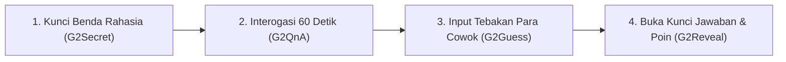

# NIRANTARA PARTYGAMES — SPESIFIKASI GAME 02: BEAUTY EXPERT?!
> Kategori: Interogasi Rahasia • Skincare & Kosmetik Cewek vs Cowok  
> Tema Warna: Magenta Pink (`#D8317E`) | Maskot: Milo (Scallop / Sunglasses)  
> Target Pembaca: Reviewer Sistem & Model AI (Gemini Neon High)

---

## 🎯 1. KONSEP & ATURAN UTAMA PERMAINAN

### 1.1. Filosofi Permainan
Dunia kosmetik dan produk perawatan wajah (skincare/makeup) memiliki ribuan istilah teknis yang sangat akrab bagi cewek, namun kerap menjadi misteri besar yang membingungkan bagi para cowok (misal: apa bedanya *Micellar Water*, *Toner*, *Essence*, dan *Serum*?).
Di game ini, perwakilan cewek memegang satu nama produk kecantikan rahasia, dan para cowok harus menginterogasinya secara live dalam batas waktu 60 detik untuk menebak nama benda tersebut.

### 1.2. Alur 4 Tahap Permainan per Slot Cewek



1. **Tahap 1: Penguncian Benda Rahasia (`G2Secret.tsx`):**
   * Sistem memilih 1 perwakilan cewek yang bertugas di slot tersebut.
   * Muncul modal privasi *"Oper Layar ke [Nama Cewek]"* agar para cowok tidak mengintip layar.
   * Cewek melihat nama produk rahasianya (misal: *"Penjepit Bulu Mata"* atau *"Cushion"*).
   * Cewek menekan tombol *"Saya Sudah Ingat Benda Ini! (Mulai Sesi)"*.
2. **Tahap 2: Sesi Interogasi Live 60 Detik (`G2QnA.tsx`):**
   * Layar kembali menghadap seluruh ruangan. Timer 60 detik mulai berjalan.
   * Para cowok secara bergantian menembakkan pertanyaan interogasi ke cewek tersebut.
   * **Aturan Mutlak Cewek:** Cewek **HANYA BOLEH** menjawab dengan 3 opsi:
     1. `"Ya"`
     2. `"Tidak"`
     3. `"Bisa Jadi / Ragu-ragu"`
   * Host dapat mencatat pertanyaan dan jawaban penting di form host helper untuk dijadikan rangkuman.
3. **Tahap 3: Input Tebakan Para Cowok (`G2Guess.tsx`):**
   * Waktu interogasi habis! Kini giliran para cowok memasukkan tebakan mereka.
   * Menggunakan mekanisme oper layar (*pass-the-device*) rahasia: Cowok 1 memasukkan tebakan dan mengunci layar $\rightarrow$ Cowok 2 memasukkan tebakan $\rightarrow$ dst.
4. **Tahap 4: Pembukaan Rahasia & Penilaian (`G2Reveal.tsx`):**
   * Host membuka jawaban asli di layar besar di hadapan seluruh ruangan.
   * Sistem menampilkan tebakan masing-masing cowok.
   * **Host Override Button:** Host memiliki tombol kendali untuk mengoreksi tebakan mirip/sinonim.

---

## ⚖️ 2. SISTEM SKOR & PENILAIAN DUAL (KUBU VS INDIVIDU)

Game ini memiliki dua lapisan skor: **Skor Kubu (Cewek vs Cowok)** untuk gengsi tim dan **Skor Individu** yang terakumulasi ke saldo Room masing-masing pemain:

| Skenario Hasil Ronde | Poin Kubu Tim | Poin Individu Pemain |
| :--- | :---: | :---: |
| **Ada Cowok yang Berhasil Menebak Benar** | **+10 Poin** Kubu Cowok | **+3 Poin** Room untuk setiap cowok yang tebakannya tepat |
| **Cewek Sukses Mengelabui (Semua Cowok Salah Tebak)** | **+10 Poin** Kubu Cewek | **+4 Poin** Room untuk cewek pemegang rahasia |
| **Seluruh Cowok Gagal Total** | 0 Poin Kubu Cowok | 0 Poin untuk cowok penebak |

---

## 🚨 3. TEMUAN AUDIT KRITIS & SOLUSI TEKNIS GAME 2

### 3.1. Masalah Pencocokan Jawaban Kaku (*Exact String Matching Bug*)
* **Masalah:** Di `G2Guess.tsx:55`, tebakan cowok divalidasi kaku dengan:
  ```typescript
  correct: g.guess.toLowerCase().trim() === slot.secretItem.toLowerCase().trim()
  ```
  Jika benda aslinya adalah `"Penjepit Bulu Mata"`, dan cowok mengetik *"jepitan bulu mata"*, *"jepit bulumata"*, atau *"eyelash curler"*, sistem secara tidak adil menandainya sebagai **SALAH**.
* **Solusi Wajib:**
  Di layar `G2Reveal.tsx`, setiap baris tebakan cowok wajib dilengkapi **Tombol Toggle Host Override**:
  * Tombol hijau: `[✓ Tandai Benar (+3 Pts)]`
  * Tombol merah: `[✗ Tandai Salah]`
  Dengan demikian, jika host dan audiens sepakat bahwa jawaban tersebut secara konteks benar, host bisa mengubah keputusan seketika.

### 3.2. Ekspansi Bank Data Item (Dari 26 Menjadi 60+ Produk)
Bank data `MAKEUP_ITEMS` di `game2-items.ts` diperluas dari 26 item menjadi 60+ produk dengan kategori:
1. **Skincare Dasar:** *Micellar Water, Facial Wash, Toner Eksfoliasi, Serum Niacinamide, Sunscreen Stick, Moisturizer Gel, Clay Mask, Sheet Mask, Eye Cream, Acne Spot Gel*.
2. **Makeup Wajah:** *Cushion, Foundation Cair, Concealer, Bedak Tabur (Loose Powder), Compact Powder, Setting Spray, Primer Wajah, Contour Stick, Highlighter, Blush On Peach, Bronzer*.
3. **Produk Bibir:** *Lip Tint, Matte Lip Cream, Lip Balm, Lip Gloss, Lip Liner, Lip Mask, Tinted Lip Oil*.
4. **Alat Kecantikan & Aplikator:** *Penjepit Bulu Mata (Eyelash Curler), Beauty Blender, Kuas Foundation, Spatula Makeup, Kapas Wajah, Gua Sha, Roller Giok, Pinset Alis, Lem Bulu Mata Palsu*.
5. **Perawatan Rambut & Tubuh:** *Dry Shampoo, Hair Serum, Catokan Rambut, Hair Mist, Body Scrub Lulur*.

### 3.3. Penanganan Jika Grup Pemain 100% Cowok atau 100% Cewek
* Jika suatu party hanya beranggotakan cowok (misal 6 cowok):
  Fungsi `autoStartGame2` di store otomatis membagi 3 orang menjadi kubu pemegang rahasia dan 3 orang menjadi penebak.
* **Perbaikan Teks Label UI:** Ganti teks kaku *"Cewek Pemegang Rahasia"* menjadi teks adaptif:
  * Jika pemainnya cowok: *"Kubu Pemegang Rahasia (Tim Rahasia)"*.
  * Jika pemainnya cewek: *"Kubu Cewek Pemegang Rahasia"*.

---

## 🔍 4. PENANGANAN KASUS KHUSUS (*EDGE CASES*)

### A. Bagaimana jika cewek tidak sengaja membocorkan nama produk saat interogasi?
* Cewek langsung dinyatakan gugur/diskualifikasi. Kubu Cowok otomatis mendapatkan kemenangan ronde, dan cewek tersebut wajib mengambil kartu hukuman kocak dari deck hukuman.

### B. Bagaimana jika jumlah cewek dan cowok tidak seimbang (misal 7 cewek vs 3 cowok)?
* Sistem menjalankan slot sebanyak jumlah cewek (7 slot). Ke-3 cowok bergantian menebak di setiap slot. Poin dihitung adil berdasarkan rasio tebakan yang tepat.

### C. Bagaimana jika host salah pencet lanjut slot di layar Reveal?
* Tersedia tombol **"Undo Slot"** di Host Utility Bar yang membatalkan perolehan poin dan mengembalikan sesi ke pertanyaan sebelumnya.
