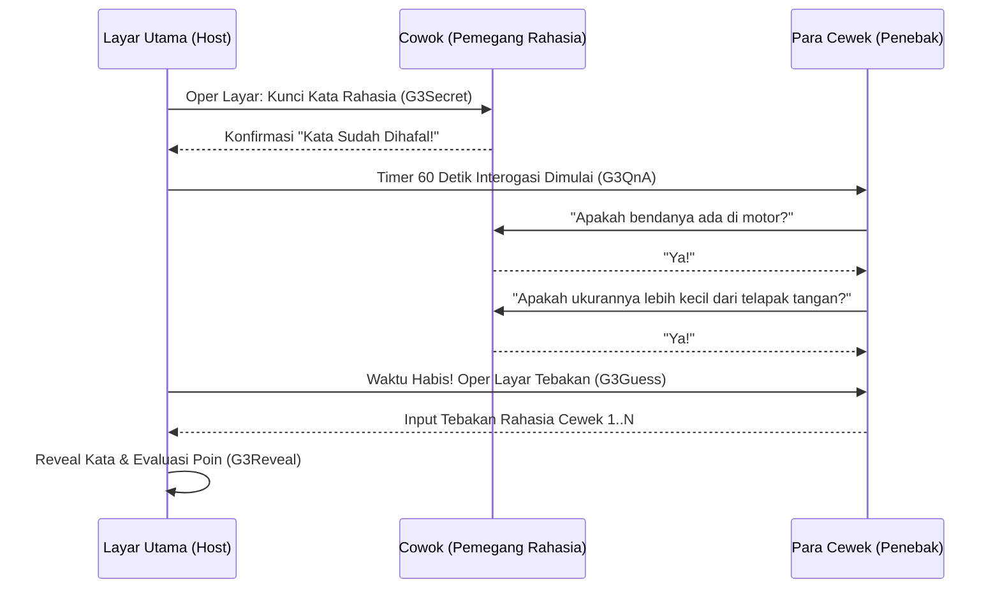

# NIRANTARA PARTYGAMES — SPESIFIKASI GAME 03: BOYS STUFF, GIRLS GUESS!
> Kategori: Interogasi Rahasia • Sparepart, Perkakas, Game PS & Olahraga  
> Tema Warna: Cobalt Blue (`#2568EF`) | Maskot: Zuzu (Pentagon / Crown)  
> Target Pembaca: Reviewer Sistem & Model AI (Gemini Neon High)

---

## 🎯 1. KONSEP & ATURAN UTAMA PERMAINAN

### 1.1. Filosofi Permainan
Merupakan kebalikan simetris dari Game 02. Kali ini giliran **dunia cowok** yang diuji! Dunia tongkrongan cowok dipenuhi dengan benda-benda otomotif, perkakas pertukangan rumah, game rental PlayStation legendaris, serta istilah olahraga yang sering kali membuat para cewek bingung atau mengernyitkan dahi.
Perwakilan cowok memegang satu kata rahasia dari kategori yang dipilih, dan para cewek diberi kesempatan 60 detik untuk mengajukan pertanyaan interogasi sebelum menebak jawabannya.

### 1.2. 5 Kategori Pilihan Konten (`game3-words.ts`)
Berbeda dengan Game 2 yang spesifik kosmetik, Game 3 memiliki 5 pilihan kategori tematik yang dapat dipilih host:
1. **Sparepart & Komponen Motor:** *Busi, Karburator, Knalpot Brong, Spion Jalu, Aki Motor, Kampas Rem, V-Belt Matic, Oli Samping, Rantai Motor, Shockbreaker, Ban Tubeless, Piringan Cakram, Radiator, Velg Bintang*.
2. **Perkakas & Alat Tukang Rumah:** *Obeng Kembang (+), Tang Buaya, Palu Martil, Kunci Inggris, Gergaji Kayu, Meteran Gulung, Bor Listrik, Solder Listrik, Tespen Listrik, Pompa Ban Manual, Lem Tembak, Amplas Kayu*.
3. **Rental PS & Game Tongkrongan:** *PlayStation 2 (PS2), Memory Card 8MB, Rental PS Billing, GTA San Andreas, Winning Eleven, Stick Getar PS, Cheat Kebal GTA, Game Boy, Mobile Legends, Tamiya 4WD*.
4. **Hobi, Gym & Olahraga Cowok:** *Futsal Malam, Barbel Gym, Bench Press, Push Up, Tarik Tambang, Kopi Hitam Panas, Karambol, Papan Catur*.
5. **Pesepakbola Legendaris (Super Terkenal):** *Cristiano Ronaldo (CR7), Lionel Messi, David Beckham, Neymar Jr, Kylian Mbappé, Zinedine Zidane, Ronaldinho, Erling Haaland, Diego Maradona, Pelé, Bambang Pamungkas*. (Dipilih hanya atlet kelas dunia yang sangat familiar, anti-niche).

---

## 🔄 2. ALUR PERMAINAN (UX FLOW)



1. **G3Secret:** Perwakilan cowok melihat kata rahasia (misal: *"Tang Buaya"* atau *"Busi"*).
2. **G3QnA:** 60 Detik interogasi live. Cowok **HANYA BOLEH** menjawab:
   * `"Ya"`
   * `"Tidak"`
   * `"Bisa Jadi / Ragu-ragu"`
3. **G3Guess:** Mekanisme oper layar rahasia agar para cewek memasukkan tebakan masing-masing tanpa saling mencontek.
4. **G3Reveal:** Buka jawaban di hadapan seluruh ruangan + validasi juri host.

---

## ⚖️ 3. SISTEM SKOR & PENILAIAN

| Skenario Hasil Ronde | Poin Kubu Tim | Poin Individu Pemain |
| :--- | :---: | :---: |
| **Ada Cewek yang Berhasil Menebak Benar** | **+10 Poin** Kubu Cewek | **+3 Poin** Room untuk setiap cewek yang tebakannya tepat |
| **Cowok Sukses Mengelabui (Semua Cewek Salah Tebak)** | **+10 Poin** Kubu Cowok | **+4 Poin** Room untuk cowok pemegang rahasia |
| **Seluruh Cewek Gagal Total** | 0 Poin Kubu Cewek | 0 Poin untuk cewek penebak |

---

## 🚨 4. TEMUAN AUDIT & SOLUSI TEKNIS GAME 3

### 4.1. Masalah Pencocokan Teks & Tombol Host Override
* Sama seperti Game 2, di `G3Guess.tsx:55`:
  ```typescript
  correct: g.guess.toLowerCase().trim() === slot.secretWord.toLowerCase().trim()
  ```
  Jika kata rahasianya adalah `"Cristiano Ronaldo (CR7)"`, dan cewek menebak *"Ronaldo"* atau *"CR7"*, sistem lama menganggapnya SALAH.
* **Solusi Wajib:**
  Di layar `G3Reveal.tsx`, sediakan tombol **[✓ Benar]** dan **[✗ Salah]** di samping nama setiap penebak agar Host bisa menyetujui tebakan yang mengarah ke objek yang sama.

### 4.2. Penyesuaian Dinamis Single-Gender Group
* Jika pemain semuanya cewek atau semuanya cowok, sistem store secara otomatis membagi 50:50. Label UI disesuaikan secara cerdas menjadi *"Kubu Pemegang Rahasia"* dan *"Kubu Penebak"*.

---

## 🔍 5. PENANGANAN KASUS KHUSUS (*EDGE CASES*)

### A. Bagaimana jika cewek tidak tahu sama sekali benda apa itu setelah di-reveal?
* Momen edukasi dan tawa! Cowok pemegang rahasia wajib menjelaskan dalam 1 kalimat fungsi benda tersebut di hadapan ruangan (misal: *"Tang buaya itu tang yang mulutnya bisa ngunci sendiri pas gigit baut!"*).

### B. Bagaimana jika ada cewek yang menebak merek dagang bukan nama benda (misal tebak "Honda" bukan "V-Belt")?
* Host berhak menggunakan tombol override untuk memutuskan apakah jawaban tersebut terlalu umum (salah) atau dapat diterima.

### C. Bagaimana jika cowok berbohong saat menjawab "Ya/Tidak" di sesi tanya?
* Jika terbukti salah memberi info (misal busi dibilang letaknya di stang motor), cowok otomatis terkena diskualifikasi dan wajib mengambil kartu hukuman!
