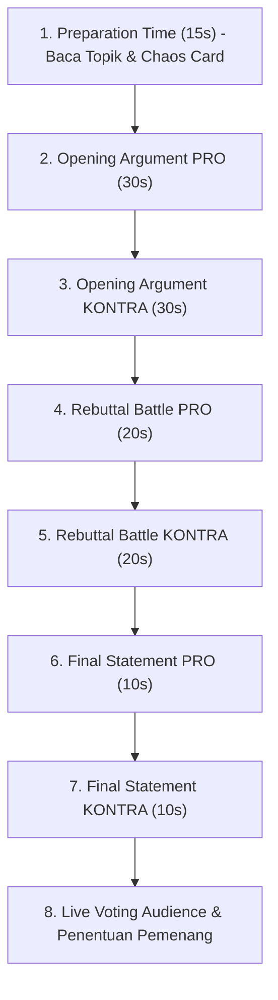

# NIRANTARA PARTYGAMES — SPESIFIKASI GAME 04: THE DEVIL'S ADVOCATE (2v2)
> Kategori: Adu Bacot Tim 2 vs 2 • Topik Absurd & Chaos Card  
> Tema Warna: Terracotta Orange (`#E85D2A`) | Maskot: Bimi (Triangle / Cheeks)  
> Target Pembaca: Reviewer Sistem & Model AI (Gemini Neon High)

---

## 🎯 1. KONSEP & EVOLUSI PERMAINAN (2v2 TIM)

### 1.1. Filosofi & Perubahan dari Versi Lama
Awalnya game ini dirancang 1 lawan 1 (*1v1*), namun berdasarkan evaluasi uji coba tongkrongan, format 1v1 kerap membuat satu orang merasa canggung atau kehabisan kata-kata (*nervous*). Oleh karena itu, sistem di-refine menjadi **Pertarungan Tim 2 vs 2 (Duo PRO vs Duo KONTRA)**.
Dengan format 2v2:
* Dua pemain di tim yang sama bisa saling melempar argumen, menimpali (*tag-team*), dan tertawa bersama.
* Pertarungan menjadi jauh lebih dinamis, heboh, dan tidak membosankan.

### 1.2. Elemen Inti: Topik Absurd + Kartu Kondisi Chaos
1. **Topik Debat Keseharian Absurd (`game4-topics.ts`):** Topik yang diangkat bukan isu politik berat, melainkan premis lucu yang sangat relate:
   * *"Mas-mas tukang parkir depan minimarket jauh lebih cocok gantiin Presiden daripada politisi."*
   * *"Bendahara kelas/kantor kita jauh lebih kompeten jadi Menteri Keuangan daripada menteri resmi."*
   * *"Besok kita semua wajib ke kampus/kantor gak usah pake celana (cuma boxer/sarung)."*
   * *"Kalau ditilang polisi, pura-pura kesurupan macan putih adalah strategi bela diri yang sah dan bermartabat."*
   * *"Makan nasi Padang pake sendok garpu adalah tindak pidana yang pantas dihukum penjara 5 tahun."*
2. **Chaos Card (Kartu Gangguan):** Masing-masing kubu diberikan instruksi konyol yang **WAJIB** dipatuhi saat berbicara:
   * *Wajib berargumen dengan intonasi sinetron azab Indosiar (dramatis & melotot).*
   * *Wajib berargumen seperti motivator MLM yang terlalu optimis.*
   * *Setiap kalimat wajib diawali dengan batuk kering palsu.*
   * *Wajib berbicara dengan gaya bahasa baku formal ala sidang skripsi.*

---

## ⏱️ 2. TAHAPAN RONDE DEBAT (7-STAGE TIMED BATTLE)

Game memiliki rangkaian timer otomatis dengan suara lonceng gong dan tick penanda waktu:

* **Host Fast-Forward Assist:** Host dapat melewati (*skip*) tahap mana pun jika kedua tim sudah selesai berbicara sebelum waktu habis.

---

## 🗳️ 3. FASE VOTING PENONTON (AUDIENCE LIVE VOTE)

* Seluruh pemain lain di ruangan yang sedang tidak bertanding bertindak sebagai **Dewan Juri / Audiens**.
* Host menghitung perolehan suara audiens dan menekan tombol tambah suara di layar:
  * Tombol `[+1 Suara Tim PRO]`
  * Tombol `[+1 Suara Tim KONTRA]`
* Tim dengan perolehan suara terbanyak dinyatakan sebagai **Pemenang Debat**.

---

## ⚖️ 4. SISTEM SKOR & REKAP PERFORMA

| Hasil Pertandingan 2v2 | Poin ke Saldo Room | Keterangan |
| :--- | :---: | :--- |
| **Duo Pemenang Vote (Juara)** | **+8 Poin** (Tiap Anggota) | Masing-masing anggota tim pemenang mendapat +8 poin. |
| **Duo Runner-Up (Kalah Vote)** | **+2 Poin** (Tiap Anggota) | Poin konsolasi atas keberanian berdebat kocak. |
| **Hasil Seri (Draw / Imbang)** | **+4 Poin** (Tiap Anggota) | Jika perolehan vote sama kuat. |
| **Eksekusi Chaos Card Sukses** | **+2 Poin Bonus** | Jika tim berhasil mematuhi kartu tantangan dengan heboh. |
| **Hukuman Tim Kalah** | Ambil Kartu Hukuman | Dua pemain di kubu yang kalah wajib menjalani hukuman bersama. |

---

## 🔍 5. PENANGANAN KASUS KHUSUS (*EDGE CASES*)

### A. Bagaimana jika jumlah pemain ganjil (misal 5, 7, atau 9 orang)?
* Sistem `autoStartGame4` secara cerdas mengacak kelipatan 4 untuk masuk arena 2v2 terlebih dahulu. Pemain sisanya bertindak sebagai **Dewan Juri Utama (Head Judge)** yang memiliki hak suara ganda dalam voting, kemudian dirotasi di match berikutnya.

### B. Bagaimana jika salah satu anggota tim 2v2 pasif / diam saja?
* Rekan setimnya dapat mengambil alih (*carry the team*). Karena poin kemenangan diberikan ke tim (+8 poin ke keduanya), rekan yang jago bicara dapat menyelamatkan pasangannya.

### C. Bagaimana jika Host salah menekan tim pemenang di voting?
* Terdapat tombol **"Undo Match"** di `G4Results` dan `G4RoundResult` yang secara aman membatalkan penambahan poin (+8/-2), merollback match, dan mengembalikan juri ke fase voting.
