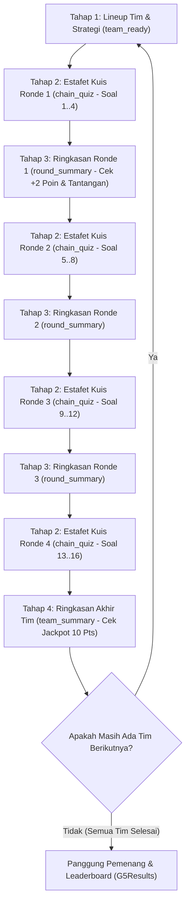

# NIRANTARA PARTYGAMES — SPESIFIKASI GAME 05: CHAIN QUIZ RELAY (CERDAS CERMAT BERANTAI)
> Kategori: Cerdas Cermat Tim Estafet • 4 Ronde Beruntun (16 Soal)  
> Tema Warna: Purple Violet (`#7C3AED`) | Maskot: Nori (Clover / Cheeks)  
> Target Pembaca: Reviewer Sistem & Model AI (Gemini Neon High)

---

## 🎯 1. KONSEP & STRUKTUR 16 SOAL ESTAFET

### 1.1. Filosofi & Alur Turnamen
Game ini mensimulasikan cerdas cermat televisi berkecepatan tinggi dengan sistem estafet anggota tim:
* **1 Tim maju sekaligus ke depan panggung dan bermain selama 4 Ronde Beruntun (Total 16 Soal)** tanpa diselingi oleh tim lawan.
* **1 Ronde = 4 Soal Berantai**. Urutan menjawab berputar adil di antara anggota tim (#1 $\rightarrow$ #2 $\rightarrow$ #3 $\rightarrow$ #4).
* Setiap ada anggota yang **salah menjawab**, anggota tersebut langsung terkena **-2 Poin penalti** dan mendapatkan **Kartu Tantangan Konyol** yang **WAJIB DIJALANKAN TERUS SAMPAI RONDE KE-4 SELESAI!**
* Setelah 1 tim menuntaskan ke-16 soalnya, giliran tim berikutnya yang maju ke panggung dengan pola 16 soal yang sama.
* Di akhir turnamen, ditampilkan **Papan Klasemen Akhir (Leaderboard)**: Tim Juara 1 dan Pemain MVP Perorangan.

---

## 🔄 2. ALUR PERMAINAN (4 STAGES FLOW)

---

## 🖥️ 3. SPESIFIKASI UI & TAMPILAN LAYAR (`G5Play.tsx`)

### 3.1. Stepper Visual 4 Ronde (Pipeline Utama)
Di bagian atas layar terpampang 4 kapsul ronde:
* `✓ Ronde 1` (Hijau jika selesai)
* `▶ Ronde 2` (Ungu menyala dengan ring glow jika sedang aktif)
* `Ronde 3`, `Ronde 4` (Abu-abu netral)

### 3.2. Stepper Estafet Soal Ronde Aktif (4 Soal)
Di bawah pipeline ronde, terdapat jalur estafet 4 soal untuk ronde yang sedang berjalan:
* Menampilkan avatar dan nama anggota tim yang bertanggung jawab menjawab soal tersebut (`S1: Alya`, `S2: Budi`, `S3: Caca`, `S4: Dara`).
* Indikator status: `✓ Benar` (Hijau), `❌ Salah` (Merah), atau `▶ Aktif` (Ungu pulsasi).

### 3.3. Banner Kartu Tantangan Aktif (Persistent Challenges)
Jika ada anggota tim yang salah menjawab di soal-soal sebelumnya, banner kuning menyala muncul di atas kartu soal:
* **"⚠️ KARTU TANTANGAN AKTIF (BERLAKU SAMPAI RONDE 4 SELESAI):"**
* Menampilkan avatar anggota yang kena hukuman, nomor ronde saat terkena, dan bunyi tantangannya (misal: *"Budi (Kena R#1): Wajib bicara dengan huruf vokal O semua"*).

### 3.4. Kartu Soal & Kontrol Host
* **Badge Kategori:** Menampilkan ikon emoji dan nama kategori (misal: `🏛️ Kategori: Sejarah Indonesia`).
* **Tombol Ganti Soal (Shuffle):** Terletak langsung di pojok kanan atas kartu soal untuk mengganti pertanyaan seketika jika dirasa kurang cocok.
* **Teks Pertanyaan:** Font besar ukuran 24px di tengah kartu.
* **Host Spoiler Box:** Tombol *"Buka Kunci Jawaban"* yang dapat dibuka-tutup oleh host agar host tahu kunci jawaban resmi tanpa terlihat jelas oleh pemain.
* **Tombol Verdict:**
  * Tombol Hijau: `BENAR! (Lanjut Soal ✓)`
  * Tombol Merah: `SALAH! (-2 Pts & Tantangan)`
* **Host Undo Assist Pill:** *"Salah Pencet? Undo Jawaban Soal Lalu"*.

---

## ⚖️ 4. ATURAN SKOR & FORMULA PERHITUNGAN

1. **Penalti Jawaban Salah Perorangan:**
   * Setiap kali ada anggota yang salah jawab: **-2 Poin Individu** langsung dikurangkan dari saldo pemain tersebut, dan pemain tersebut mendapatkan kartu tantangan aktif.
2. **Poin Keberhasilan Ronde (+2 Poin Tim):**
   * Di akhir setiap ronde (soal ke-4), tim dievaluasi.
   * Jika tim menjawab minimal 3 dari 4 soal dengan benar: **+2 Poin** dihadiahkan untuk **SELURUH anggota tim**.
3. **Jackpot Sapu Bersih 4/4 Ronde (+10 Poin Masing-Masing):**
   * Jika satu tim berhasil menyapu bersih seluruh 4 ronde dengan sukses tanpa cacat: seluruh anggota tim mendapatkan **Jackpot Total 10 Poin perorangan**!

---

## 📚 5. BANK DATA 450 SOAL TRIVIA EDUKATIF & POP (`game5-questions.ts`)

Terdiri dari **9 Kategori Lengkap** dengan masing-masing **50 Pertanyaan Pilihan**:
1. **Sejarah Indonesia & Dunia (50 Soal):** Kerajaan Majapahit, Proklamasi, Konferensi Meja Bundar, Perang Dunia, Tembok Besar China.
2. **IPA / Sains & Fisika Sehari-hari (50 Soal):** Fotosintesis, gravitasi bumi, organ tubuh manusia, titik didih air, lapisan atmosfer.
3. **IPS & Geografi Dunia (50 Soal):** Ibu kota negara, benua terbesar, garis khatulistiwa, mata uang dunia, selat Indonesia.
4. **Politik Umum & Ketatanegaraan (50 Soal):** Lembaga negara (DPR, MPR, MK), Trias Politika, pemilu, dasar negara Pancasila.
5. **Matematika Cepat & Logika (50 Soal):** Hitungan cepat, kuadrat sederhana, bilangan prima, perbandingan rasio.
6. **Antariksa & Tata Surya (50 Soal):** Planet terbesar, planet merah (Mars), komet, gerhana matahari, satelit alami bumi (Bulan).
7. **Ilmu Pengetahuan Umum (50 Soal):** Penemu listrik, bahasa internasional, hari nasional, penemu telepon.
8. **Biologi & Dunia Hewan (50 Soal):** Mamalia bertelur, metamorfosis kupu-kupu, hewan karnivora, fungsi klorofil.
9. **Fakta Unik & Pop Culture (50 Soal):** Guinness World Records, film legendaris, makanan khas dunia, fenomena alam unik.

---

## 🔍 6. PENANGANAN KASUS KHUSUS (*EDGE CASES*)

### A. Bagaimana jika jumlah anggota tim hanya 2 orang atau 3 orang?
* Pertanyaan estafet tetap berjumlah 16 soal. Rumus perputaran anggota menggunakan operator modulo:
  `memberId = team.memberIds[globalIdx % team.memberIds.length]`
  Sehingga giliran menjawab akan berputar secara adil dan berulang (misal tim isi 3 orang: P1 $\rightarrow$ P2 $\rightarrow$ P3 $\rightarrow$ P1 $\rightarrow$ dst).

### B. Bagaimana jika Host salah memencet tombol SALAH di soal ke-4 ronde?
* Host cukup menekan tombol **"Undo Soal Lalu"**. Sistem akan secara matematis:
  1. Mengembalikan +2 poin pemain yang salah.
  2. Mencabut kartu tantangan yang baru saja diberikan.
  3. Mengembalikan tim ke stage `chain_quiz` tanpa kehilangan riwayat soal sebelumnya.

### C. Opsi Replay di Papan Klasemen Akhir (`G5Results.tsx`):
* Host diberikan 2 tombol pilihan:
  1. **Main Lagi (Kelompok Sama):** Mengambil 16 soal baru yang belum pernah muncul untuk masing-masing tim dengan susunan anggota yang tetap.
  2. **Main Lagi (Acak Ulang / Shuffle Tim):** Mengacak ulang seluruh pemain room menjadi susunan tim baru yang segar.
