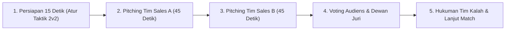

# NIRANTARA PARTYGAMES — SPESIFIKASI GAME 06: SELL ME THIS TRASH! (PITCHING DUEL 2v2)
> Kategori: Adu Rayuan Sales Tim 2 vs 2 • Jual Barang Rusak ke Pembeli Absurd  
> Tema Warna: Lime Green (`#65A30D`) | Maskot: Juno (Hexagon / Sunglasses)  
> Target Pembaca: Reviewer Sistem & Model AI (Gemini Neon High)

---

## 🎯 1. KONSEP & ATURAN UTAMA PERMAINAN

### 1.1. Filosofi Permainan
Terinspirasi dari tantangan wawancara legendaris *"Sell me this pen"*, game ini membawa premis tersebut ke tingkat komedi tongkrongan yang absurd:
* Dua tim sales (masing-masing 2 orang) ditantang untuk menjual **1 barang rongsokan / rusak parah** kepada **1 profil target pembeli yang aneh dan tidak masuk akal**.
* Kedua tim harus memeras otak mencari kelebihan tersembunyi dari barang rusak tersebut agar terdengar seperti produk revolusioner kelas dunia yang wajib dibeli oleh target pembeli tersebut.

### 1.2. Bank Data Barang Rusak & Pembeli Absurd (`game6-pitches.ts`)

#### Contoh Barang Rongsok / Cacat:
1. **Payung Bolong-Bolong Tanpa Gagang:** Kain payung robek di mana-mana dan besinya karatan.
2. **Kaset Pita Lagu Jadul yang Pita-nya Kusut:** Suara lagu meliuk-liuk seperti suara kuntilanak.
3. **Flashdisk 128 MB Berkarat:** Kapasitas cuma muat 15 lagu MP3, harus dicolok sambil ditahan jari biar kebaca.
4. **Sepatu Pantofel Cuma Sebelah Kanan (Ukuran 45):** Sepatu kulit mengkilap tapi cuma ada satu biji sebelah kanan.
5. **Kipas Angin Bunyi Helikopter Tempur:** Putarannya lambat tapi getaran dan bunyinya bikin meja bergetar.
6. **Remote TV Tanpa Tutup Baterai:** Baterainya sering lompat keluar kalau digoyang, tombol power harus ditekan pake tusuk gigi.
7. **Botol Tupperware yang Tutupnya Sudah Ilang Entah ke Mana:** Wadah kedap udara yang sudah tidak kedap udara sama sekali.

#### Contoh Profil Target Pembeli Absurd:
1. **Bapak-Bapak Komplek Super Pelit:** Nawar seribu perak aja alotnya minta ampun, selalu curiga sales mau nipu.
2. **Alien Galaksi Andromeda yang Tersesat di Bumi:** Tidak paham uang bumi tapi tertarik sama benda berkilau.
3. **Kolektor Barang Rongsok Baperan:** Gampang terharu kalau barang dagangan punya kisah sedih masa lalu.
4. **Crazy Rich Gabut yang Duitnya Gak Berseri:** Membeli apa saja asal barangnya terlihat aneh dan langka.
5. **Anak Kosan Tanggal Tua di Akhir Bulan:** Saldo rekening sisa 8 ribu perak, butuh barang serbaguna.

---

## ⏱️ 2. TAHAPAN PITCHING DUEL (MATCH STAGES)

1. **Stage 1: Preparation (15 Detik):**
   * Layar menampilkan nama barang rusak dan deskripsi calon pembeli.
   * Kedua tim berdiskusi cepat menentukan pembagian tugas (misal: P1 membuka rayuan, P2 menutup dengan diskon tipu-tipu).
2. **Stage 2: Pitching Tim A (45 Detik):**
   * Timer 45 detik berjalan. Duo Tim A berdiri mempresentasikan barang dagangannya ke hadapan seluruh ruangan.
3. **Stage 3: Pitching Tim B (45 Detik):**
   * Giliran Duo Tim B membalas dengan presentasi yang lebih kocak, menjatuhkan klaim Tim A, atau menawarkan solusi lebih kreatif.
4. **Stage 4: Live Voting Dewan Juri:**
   * Audiens (pemain lain di luar arena) mengangkat tangan menentukan tim sales mana yang rayuannya paling meyakinkan dan paling mengocok perut.

---

## ⚖️ 3. SISTEM SKOR & PENILAIAN

| Hasil Duel Sales | Poin Saldo Room | Keterangan |
| :--- | :---: | :--- |
| **Duo Tim Sales Pemenang (Juara Vote)** | **+8 Poin** (Tiap Orang) | Masing-masing anggota tim pemenang mendapat +8 Pts. |
| **Duo Tim Sales Kalah (Runner-Up)** | **+2 Poin** (Tiap Orang) | Poin konsolasi partisipasi. |
| **Hasil Vote Seri / Draw** | **+4 Poin** (Tiap Orang) | Jika juri terbagi sama banyak. |
| **Hukuman Tim Kalah** | Hukuman Kelompok | Dua pemain tim yang kalah wajib menjalani kartu hukuman bersama. |

---

## 🔍 4. PENANGANAN KASUS KHUSUS (*EDGE CASES*)

### A. Bagaimana jika tim kehabisan ide sebelum 45 detik habis?
* Host dapat menekan tombol **"Selesai Pitching Lebih Cepat"** untuk langsung memangkas sisa waktu dan memanggil tim lawan maju.

### B. Bagaimana jika barang yang muncul dirasa kurang seru?
* Terdapat tombol **"Ganti Barang (Shuffle Item)"** langsung di kartu produk untuk mengacak barang rongsok dan target pembeli baru seketika.

### C. Bagaimana jika Host salah memasukkan jumlah suara voting?
* Host dapat menggunakan tombol **"Undo Match"** di pojok bawah untuk merollback skor dan mengulang pemungutan suara.
