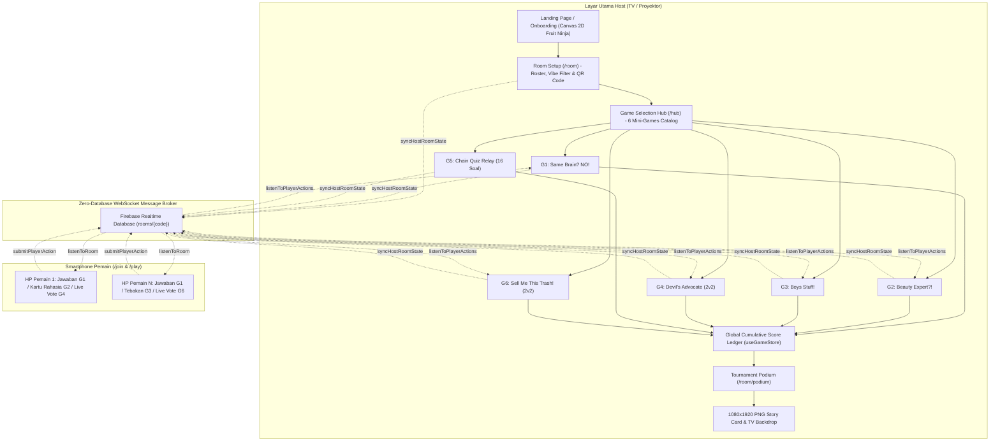

# PRODUCT REQUIREMENTS DOCUMENT (PRD)
# PartyHub Indonesia — Universal Hybrid Party Games Platform
> **Document Status:** Approved & Production-Ready  
> **Target Release:** v1.0 Public Web / PWA  
> **Date:** November 2026 | **Author:** Product & Engineering Architecture Team  
> **Repository:** `d:\Freelance\2026\boardgames` | **Branch:** `main`

---

## 1. Executive Summary

### 1.1. Problem Statement
Saat kumpul tatap muka secara luring (*offline gathering*, pesta tongkrongan, *ice-breaking* divisi kantor, atau arisan keluarga besar), acara sering kali mati gaya atau peserta terpecah ke layar smartphone masing-masing. Game pesta digital populer yang ada saat ini memiliki friksi adopsi yang tinggi:
* **Hambatan Instalasi & Akun:** Game seperti *Kahoot* atau *Jackbox* sering mewajibkan setiap peserta mengunduh aplikasi native dari app store, registrasi email/password, atau membeli lisensi berbayar berbahasa Inggris.
* **Konten Tidak Sesuai Budaya Lokal:** Topik trivia atau humor impor tidak *relate* dengan dinamika sosial masyarakat Indonesia.
* **Risiko Pelanggaran Norma (Cringe / HR Violations):** Ketiadaan filter audiens membuat materi tongkrongan liar yang tidak pantas dimainkan di acara kantor (*NSFW / harassment risk*) atau di hadapan orang tua dan anak-anak.

### 1.2. Proposed Solution: PartyHub Indonesia
**PartyHub Indonesia** adalah platform web permainan pesta kasual luring (*offline casual party games*) berbasis **Hybrid Shared-Screen Host & Mobile Controller Architecture**:
1. **Layar Utama TV / Proyektor (Host Screen):** Menampilkan teks soal raksasa yang terbaca jelas dari jarak 3–4 meter, countdown timer dramatis, panggung perdebatan, dan leaderboard skor.
2. **Controller HP Pemain (`/join` & `/play`):** Pemain di ruangan cukup memindai Kode QR di layar TV dengan kamera smartphone mereka untuk bergabung secara instan tanpa login dan tanpa unduh aplikasi. HP otomatis bertransformasi menjadi *gamepad* interaktif (mengunci jawaban unik, menampilkan kartu rahasia privat, live voting 2v2, dan memantau status estafet).
3. **100% Zero-Tech Offline Fallback:** Jika lokasi gathering tidak memiliki sinyal internet (seperti di villa pegunungan) atau baterai HP habis, seluruh permainan **tetap 100% dapat dimainkan** lewat 1 layar laptop Host secara verbal dan manual.
4. **Audience Vibe Filter:** 1 Tombol pengatur suasana ruangan yang menyaring bank data secara otomatis untuk:
   * 🔥 **Tongkrongan (Full Chaos):** Bebas sensor, adu argumen kocak, sarkasme receh, dan kartu hukuman konyol.
   * 💼 **Kantor / Corporate (SFW):** 100% *Safe For Work*, bebas SARA/politik praktis/pelecehan, humor seputar dunia kerja.
   * 🏡 **Keluarga & Arisan (All-Ages):** Ramah anak-anak hingga lansia, topik seputar rumah tangga, kuliner, dan nostalgia.

### 1.3. Success Criteria & Target KPIs
1. **Time-to-First-Round < 45 Detik:** Dari scan QR di layar TV hingga pemain memegang controller HP dan ronde 1 dimulai membutuhkan waktu kurang dari 45 detik.
2. **Crash & State Corruption Rate = 0%:** Zero data loss saat Host me-refresh tab browser, menambah pemain telat datang (*late arrival*), atau melakukan koreksi (*undo/override*).
3. **Cross-Demographic Engagement:** Skor kepuasan bermain $\ge 90\%$ di 3 segmen demografi (Tongkrongan, Kantor SFW, Keluarga Lintas Generasi).
4. **Performance & Lightweight Footprint:** Bundle JavaScript awal $\le 275\text{ kB}$ (gzip: ~87 kB) dengan First Contentful Paint (FCP) $\le 1.0\text{s}$ di jaringan seluler.
5. **Organic Post-Game Virality:** Minimal 30% sesi pesta menghasilkan unduhan atau share kartu *Party Story 9:16 PNG (1080x1920)* ke Instagram Story atau WhatsApp Group.

---

## 2. User Experience & Personas

### 2.1. User Personas
1. **Andi (22, Mahasiswa / Pegiat Tongkrongan):**
   * *Karakter:* Gemar kompetisi heboh, adu bacot spontan, tertawa lepas bersama teman kos, dan memberi hukuman receh.
   * *Kebutuhan:* Alur game cepat, topik debat absurd, dan pertanyaan anti-slop yang sangat *relate* dengan kehidupan anak muda Indonesia.
2. **Sarah (29, HRD / Event Lead Kantor):**
   * *Karakter:* Memimpin sesi *team-building* dan *townhall* kantor beranggotakan 10–20 rekan kerja lintas divisi.
   * *Kebutuhan:* Game yang memecah kebekuan (*ice breaking*), bersih dari materi sensitif/pelecehan (100% *Safe For Work*), dan tidak membuat atasan canggung.
3. **Pak Budi (48, Kepala Keluarga / Pengurus Arisan):**
   * *Karakter:* Berkumpul bersama anak-anak, keponakan, dan orang tua saat Idulfitri, Natal, atau liburan keluarga besar.
   * *Kebutuhan:* Teks di layar TV terbaca jelas dari jarak 3–4 meter, istilah bahasa Indonesia natural, dan topik seputar kebiasaan rumah tangga.

---

## 3. User Stories & Acceptance Criteria

### US-01: Setup Room, Kode QR, & Audience Vibe Filter (`/room`)
* **User Story:** *Sebagai Host acara, saya ingin membuat room dengan Kode 4-Huruf unik dan menampilkan Kode QR di TV, agar teman-teman di ruangan bisa langsung scan dan bergabung tanpa repot mengetik URL.*
* **Acceptance Criteria (AC):**
  - [x] Host dapat memberi nama room dan sistem otomatis menghasilkan kode 4-huruf kata Indonesia unik (`ASIK`, `SERU`, `KOST`, `NONG`, dll.).
  - [x] Komponen Kode QR SVG native (`QRCodeDisplay.tsx`) ditampilkan di layar TV dengan styling Neo-Brutalist border.
  - [x] Terdapat toggle *Audience Vibe Filter*: `🔥 Tongkrongan`, `💼 Kantor / SFW`, dan `🏡 Keluarga & Arisan`.
  - [x] Host dapat memilih Preset Cepat (6, 8, atau 10 pemain) atau menambah pemain manual (2 s/d 20 orang) dengan avatar 3D ekspresif.
  - [x] Fitur *Late Arrival* (`addLatePlayer` dengan opsi skor median/nol) dan *Dropout* (`deactivatePlayer`) beroperasi tanpa merusak permainan yang sedang berjalan.
  - [x] Seluruh state dipersistensi di `localStorage` via Zustand (`party_games_room_storage_v1`).

### US-02: Mobile Controller Pemain (`/join` & `/play`)
* **User Story:** *Sebagai pemain di ruangan, saya ingin menggunakan HP saya sebagai gamepad tanpa install aplikasi, agar saya bisa mengetik jawaban rahasia dan melakukan live voting dari tempat duduk saya.*
* **Acceptance Criteria (AC):**
  - [x] URL `/join?code=XXXX` otomatis membaca parameter kode dari scan QR.
  - [x] Form join menyimpan data pemain ke `sessionStorage` HP (tahan accidental refresh).
  - [x] Rute `/play` menyinkronkan state game secara realtime via WebSockets Firebase RTDB:
    - *Lobby:* Menampilkan status "TERHUBUNG KE LAYAR TV".
    - *Game 1:* Form ketik 1 jawaban unik dan tombol "Kunci Jawaban".
    - *Game 2 & 3:* Kartu rahasia privat (jika pemegang rahasia) atau form tebakan (jika penebak).
    - *Game 4 & 6:* Tombol voting live tim 2v2.
    - *Game 5:* Sinkronisasi soal trivia dan status giliran estafet.
    - *Podium:* Animasi konfeti personal dan tampilan ranking individu.

### US-03: Game 01 — Same Brain? NO! (Asosiasi Kata Anti-Kembar)
* **User Story:** *Sebagai pemain, saya ingin memikirkan kata seunik mungkin saat Host membacakan topik, agar saya tidak memiliki jawaban kembar dengan orang lain.*
* **Acceptance Criteria (AC):**
  - [x] Timer 30 detik countdown dengan audio metronom (berubah merah darurat di $\le 5$ detik).
  - [x] Mode Hybrid: Jawaban yang diketik pemain di HP Controller otomatis muncul di grid layar TV di bawah kartu pemain.
  - [x] Mode Verbal: Host dapat memandu hitungan mundur tiga detik dan mengetuk kartu pemain kembar secara manual.
  - [x] Sistem Skor: Unik `+2 Pts`, Kembar/Blank/Ngawur `-1 Pt` penalti.
  - [x] Hak Veto Ruangan: Jawaban ngawur/asal yang ditolak ruangan ditandai sebagai penalti.
  - [x] Tombol *Shuffle Kategori* untuk mengganti soal dari 50 bank soal relate Indonesia tanpa pengulangan.

### US-04: Game 02 & 03 — Interogasi Rahasia (Beauty Expert & Boys Stuff)
* **User Story:** *Sebagai tim penebak, saya ingin menginterogasi pemegang rahasia selama 60 detik (dengan jawaban Ya/Tidak/Bisa Jadi) lalu menebak nama benda, agar tim saya meraih poin kemenangan.*
* **Acceptance Criteria (AC):**
  - [x] Kartu rahasia tampil di HP pemegang rahasia secara privat sehingga tidak perlu maju ke laptop Host.
  - [x] Batas kuota jawaban "Bisa Jadi" maksimal 2x per ronde untuk mencegah pemain mengulur waktu.
  - [x] Mode "Layar TV / Kertas" mencegah risiko kabel HDMI proyektor lepas akibat pass-the-device.
  - [x] *Fuzzy Matching Engine* (`fuzzyMatch.ts`) menoleransi typo (jarak $\le 2$) dan mengenali 30+ sinonim alias.
  - [x] **Host Override Mutlak:** Host memiliki tombol toggle `[✓ Benar]` dan `[✗ Salah]` di layar Reveal.
  - [x] Label kubu otomatis beradaptasi menjadi *"Sang Insider"* vs *"Skuad Detektif"* jika grup beranggotakan *single-gender* (100% cowok / 100% cewek).
  - [x] Tersedia 68 item kosmetik + 35 item peralatan dapur/rumah tangga untuk mode keluarga.

### US-05: Game 04 & 06 — Duel 2v2 (The Devil's Advocate & Sell Me This Trash!)
* **User Story:** *Sebagai pasangan bertanding 2v2, saya ingin saling menimpali argumen membela topik absurd / menjual barang rusak, agar audiens memberikan vote kemenangan untuk tim kami.*
* **Acceptance Criteria (AC):**
  - [x] Sistem mengundi format 2 vs 2 dengan penyeimbang *Fair-Queue* (pemain yang paling jarang bertanding diprioritaskan maju).
  - [x] Timeline 8 tahap di G4 (Prep 15s $\rightarrow$ Opening 30s $\rightarrow$ Rebuttal 20s $\rightarrow$ Final 10s $\rightarrow$ Live Vote).
  - [x] Timeline 4 tahap di G6 (Prep 15s $\rightarrow$ Pitch Sales A 45s $\rightarrow$ Pitch Sales B 45s $\rightarrow$ Live Vote).
  - [x] **Lonceng Wajib Tag-Team (Anti Free-Rider):** Audio lonceng otomatis berbunyi di paruh waktu (detik 15/10 di G4, detik 22 di G6) sebagai sinyal wajib oper mic ke rekan setim.
  - [x] Live Audience Voting: Suara vote dari HP audiens langsung terakumulasi secara real-time di layar TV proyektor.
  - [x] Skor: Menang Vote `+8 Pts tiap orang`, Kalah Vote `+2 Pts konsolasi`, Bonus Chaos Card `+2 Pts`.

### US-06: Game 05 — Chain Quiz Relay (16 Soal Estafet Beruntun)
* **User Story:** *Sebagai tim estafet, kami ingin menyelesaikan 4 ronde kuis trivia beruntun (16 soal) dengan lancar, sambil memegang kartu tantangan jika ada yang salah jawab.*
* **Acceptance Criteria (AC):**
  - [x] 1 Tim menyelesaikan 4 ronde (16 soal) beruntun tanpa diselingi tim lain.
  - [x] Timer 15 detik countdown otomatis per soal dengan audio ticking dramatis dan kontrol pause/resume.
  - [x] Setiap salah jawab: pemain terkena `-2 Pts` dan mendapatkan *Kartu Tantangan Konyol* yang **wajib aktif hingga Ronde 4 selesai**. Tantangan bersifat kumulatif jika salah berulang kali.
  - [x] Lolos ronde ($\ge 3/4$ benar) memberikan `+2 Pts tim`.
  - [x] Sapu bersih sempurna 16/16 benar memberikan bonus jackpot `10 Pts penuh` untuk masing-masing anggota.
  - [x] Bank data 450 soal trivia dalam 9 kategori komprehensif.

### US-07: Panggung Juara, Hukuman, & Party Wrapped Social Share (`/room/podium`)
* **User Story:** *Sebagai peserta pesta, kami ingin melihat tangga podium Juara 1–3, memutar hukuman 3 terbawah, dan membagikan kartu story pesta beresolusi tinggi ke media sosial.*
* **Acceptance Criteria (AC):**
  - [x] Tangga podium 3 tingkat dengan animasi konfeti 60 FPS dan audio fanfare megah.
  - [x] 3 Terbawah otomatis diarahkan ke modal roulette hukuman yang disesuaikan dengan Vibe Filter.
  - [x] Fitur *Party Wrapped Superlatives*: menganugerahkan gelar konyol (*The Ultimate MVP, The Mastermind, Chaos Gremlin, Sultan Hoki, Silent Carry*).
  - [x] **Generator Kartu Story 1080x1920 PNG:** Menggunakan HTML5 Canvas 2D murni untuk merender kartu vertikal resolusi tinggi siap share ke Instagram Story / WhatsApp.
  - [x] Mode Foto Bareng (*TV Backdrop Mode*): mengangkat teks juara ke 40% area atas layar TV dan membersihkan 60% area bawah untuk foto rombongan.

---

## 4. Technical Specifications & Architecture

### 4.1. Architecture Diagram (Hybrid Shared-Screen + Realtime Controller)


### 4.2. Core Data Models (TypeScript)
```typescript
export type RoomVibe = 'family' | 'office' | 'tongkrongan';
export type Gender = 'cowok' | 'cewek';
export type PlayerStatus = 'active' | 'inactive';

export type Player = {
  id: string;
  name: string;
  gender?: Gender;
  kubu: string;
  score: number;
  avatarId?: string;
  status?: PlayerStatus;
  joinedLate?: boolean;
};

export interface OnlinePlayer {
  id: string;
  name: string;
  avatarId: string;
  gender: Gender;
  kubu: string;
  score: number;
  isHost?: boolean;
  isOnline: boolean;
  lastActive: number;
}

export interface PlayerAction {
  id: string;
  playerId: string;
  playerName: string;
  type:
    | 'submit_g1_answer'
    | 'submit_g2_guess'
    | 'submit_g3_guess'
    | 'cast_g4_vote'
    | 'cast_g6_vote'
    | 'buzz_g5';
  payload: any;
  timestamp: number;
}

export interface OnlineRoomData {
  code: string;
  name: string;
  vibe: RoomVibe;
  hostId: string;
  createdAt: number;
  status: 'lobby' | 'playing' | 'podium';
  activeGame?: string | null;
  gamePhase?: string | null;
  gameState?: Record<string, any>;
  players: Record<string, OnlinePlayer>;
  actions?: Record<string, PlayerAction>;
}
```

### 4.3. Performance & Code-Splitting Benchmarks
* **Code Splitting Dinamis:** Rute dibungkus `React.lazy()` dan `<Suspense>`.
* **Ukuran Chunk Awal:** <275 kB (gzip: ~87 kB).
* **Audio Synthesis:** Web Audio API Procedural Oscillators (0 KB file audio eksternal, latensi <5ms).
* **Canvas Simulation:** 60 FPS partikel ledakan maskot & confetti shower tanpa memory leak.

---

## 5. Non-Goals (Batasan Ruang Lingkup)

1. **Bukan Game Online Berbasis Akun Database SQL/NoSQL Permanen:** Tidak membutuhkan registrasi user, login Google/OAuth, atau database tabel tradisional. Komunikasi multi-device bersifat *ephemeral broker* (state hidup selama sesi pesta aktif).
2. **Bukan Pay-to-Win atau Gacha:** Tidak ada transaksi mikro (*in-app purchases*), sistem koin berbayar, atau fitur paywall.
3. **Bukan Konten Perjudian atau NSFW:** Bebas dari taruhan uang asli atau materi tidak senonoh.

---

## 6. Risk Analysis & Mitigations

| Risiko Teknis / UX | Dampak | Strategi Mitigasi Terverifikasi |
| :--- | :---: | :--- |
| **Accidental Refresh / Back Button** | Sesi permainan terputus | State tersimpan permanen di Zustand `localStorage` + `sessionStorage` HP. |
| **Kabel HDMI Terlepas saat Oper Laptop** | Layar TV padam di tengah game | Disediakan mode "Layar TV / Kertas" dan Controller HP di Game 2 & 3. |
| **Koneksi Internet Putus di Lokasi Pesta** | HP Controller tidak terhubung | Sistem otomatis fallback 100% ke mode verbal/manual di 1 laptop Host. |
| **Ketimpangan Rasio Gender Parah di G2/G3** | Satu pemain burnout jadi penjaga rahasia terus | Sistem otomatis beralih ke Mode Netral ("Sang Insider" vs "Skuad Detektif") atau tema dapur. |
| **Pemain Pasif di Tim Debat 2v2 (Free-Rider)** | Poin tidak adil bagi partner | Lonceng otomatis paruh waktu (detik 15/22) mewajibkan oper mic ke partner setim. |
