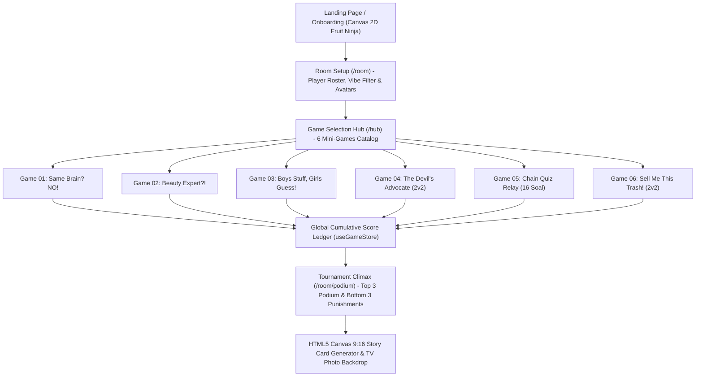

# PRODUCT REQUIREMENTS DOCUMENT (PRD)
# PartyHub Indonesia — Universal Shared-Screen Party Games Web Platform
> **Document Status:** Approved & Production-Ready  
> **Target Release:** v1.0 Public Web / PWA  
> **Date:** November 2026 | **Author:** Product & Engineering Team

---

## 1. Executive Summary

### 1.1. Problem Statement
Saat kumpul luring (tongkrongan, *ice-breaking* kantor, atau kumpul keluarga besar), acara sering kali mati gaya atau terpecah ke layar HP masing-masing karena game pesta digital populer (seperti *Kahoot* atau *Jackbox*) mewajibkan setiap peserta mengunduh aplikasi, login akun, atau membeli lisensi berbayar berbahasa Inggris yang tidak *relate* dengan dinamika sosial masyarakat Indonesia.

### 1.2. Proposed Solution
**PartyHub Indonesia** adalah platform web permainan pesta kasual luring (*offline casual party games*) berbasis **Shared-Screen Host Mode** (1 layar utama di laptop/tablet/TV yang dipandu seorang Host untuk 2–20 pemain di ruangan yang sama), gratis tanpa instalasi, tanpa login akun, beroperasi secara instan di browser, dan didesain ramah untuk **semua kalangan** (tongkrongan, korporat/SFW, dan keluarga lintas generasi).

### 1.3. Success Criteria & Target KPIs
1. **Time-to-First-Round < 60 Detik:** Dari membuka URL pertama kali hingga ronde pertama dimulai membutuhkan waktu kurang dari 1 menit.
2. **Crash & State Corruption Rate = 0%:** Zero data loss saat Host me-refresh tab, mengubah roster pemain di tengah jalan, atau salah pencet (*undo*).
3. **Cross-Demographic Engagement (Lighthouse / User Retention):** Skor kepuasan bermain $\ge 90\%$ di 3 segmen demografi (Tongkrongan, Kantor SFW, Keluarga Lintas Generasi).
4. **Performance & Lightweight Footprint:** Bundle awal JavaScript $\le 150\text{ kB}$ (gzip) dengan First Contentful Paint (FCP) $\le 1.2\text{s}$ di koneksi 4G seluler.
5. **Viral Loop Organic Share:** Minimal 25% sesi turnamen menghasilkan unduhan atau share kartu *Party Story 9:16* ke WhatsApp/Instagram Story.

---

## 2. User Experience & Functionality

### 2.1. User Personas
1. **Andi (22, Mahasiswa / Pegiat Tongkrongan):**
   * *Karakter:* Suka kompetisi heboh, adu argumen ngawur, tertawa lepas bersama teman kos, dan memberi hukuman kocak.
   * *Kebutuhan:* Alur game super cepat, topik debat absurd, dan pertanyaan anti-slop yang sangat *relate* kehidupan sehari-hari.
2. **Sarah (29, HRD / Event Lead Kantor):**
   * *Karakter:* Memimpin sesi *team-building* dan *townhall* kantor beranggotakan 10–20 rekan kerja.
   * *Kebutuhan:* Game yang memecah kebekuan (*ice breaking*), bersih dari materi sensitif/pelecehan (100% *Safe For Work*), dan tidak membuat atasan canggung.
3. **Pak Budi (48, Kepala Keluarga / Pengurus Arisan):**
   * *Karakter:* Berkumpul bersama anak-anak, keponakan, dan orang tua saat Idulfitri atau liburan keluarga.
   * *Kebutuhan:* Teks di layar TV terbaca jelas dari jarak 3–4 meter, istilah bahasa Indonesia natural (tanpa istilah teknis gamer yang membingungkan), dan topik seputar kebiasaan rumah tangga.

---

### 2.2. User Stories & Acceptance Criteria

#### US-01: Pendaftaran & Setup Room Instan
* **User Story:** *Sebagai Host acara, saya ingin mendaftarkan nama-nama teman di ruangan secara cepat tanpa meminta mereka login HP masing-masing, agar kami bisa langsung bermain tanpa kendala teknis.*
* **Acceptance Criteria (AC):**
  - [x] Host dapat memilih Preset Cepat (6, 8, atau 10 pemain) hanya dengan 1 klik.
  - [x] Host dapat menambah pemain (hingga 20 orang) dan memilih 1 dari 10 avatar maskot ekspresif.
  - [x] Terdapat pemilih suasana acara (*Vibe Filter*): `Keluarga & Arisan`, `Kantor / Corporate`, atau `Tongkrongan`.
  - [x] Data room tersimpan permanen di `localStorage` melalui Zustand `persist` (tahan reload F5).

#### US-02: Game 01 — Same Brain? NO! (Asosiasi Kata Anti-Kembar)
* **User Story:** *Sebagai pemain, saya ingin memikirkan kata seunik mungkin saat Host membacakan topik, agar saya tidak memiliki jawaban kembar dengan orang lain.*
* **Acceptance Criteria (AC):**
  - [x] Timer 30 detik hitung mundur dengan audio metronom (berubah nada darurat di $\le 5$ detik).
  - [x] Host dapat menandai pemain dengan jawaban kembar (*Twin Brain*) dalam 1 kali sentuh (*tap*).
  - [x] Poin otomatis terhitung: Unik `+2 Pts`, Kembar/Blank `-1 Pt`.
  - [x] Tersedia tombol *Shuffle Kategori* untuk mengganti soal instan dari 50 bank soal terkurasi.

#### US-03: Game 02 & 03 — Interogasi Rahasia (Beauty Expert & Boys Stuff)
* **User Story:** *Sebagai tim penebak, saya ingin menginterogasi pemegang rahasia selama 60 detik (dengan jawaban Ya/Tidak) lalu menebak nama benda, agar tim saya meraih poin kemenangan.*
* **Acceptance Criteria (AC):**
  - [x] Tersedia mode "Layar TV / Proyektor" agar penebak tidak perlu mengoper-oper kabel laptop Host.
  - [x] Pencocokan tebakan didukung *Fuzzy Matching* (toleran typo, spasi, dan alias seperti "CR7" atau "jepit bulu mata").
  - [x] **Host Override Mutlak:** Host memiliki tombol toggle `[✓ Benar]` dan `[✗ Salah]` di layar Reveal untuk menganulir tebakan yang relevan.
  - [x] Label kubu otomatis beradaptasi menjadi *"Sang Insider"* vs *"Skuad Detektif"* jika grup beranggotakan *single-gender* (100% cowok / 100% cewek).

#### US-04: Game 04 & 06 — Duel 2v2 (The Devil's Advocate & Sell Me This Trash!)
* **User Story:** *Sebagai pasangan bertanding 2v2, saya ingin saling menimpali argumen membela topik absurd / menjual barang rusak, agar audiens memberikan vote kemenangan untuk tim kami.*
* **Acceptance Criteria (AC):**
  - [x] Sistem membagi pemain ke format 2 vs 2 dengan penyeimbang *Fair-Queue* (pemain yang paling jarang bertanding diprioritaskan maju).
  - [x] Jika jumlah pemain ganjil (misal 5 pemain), pemain ke-5 bertindak sebagai *Aktor Pembeli Absurd* (G6) atau *Hakim Ketua* (G4) dengan hak suara juri.
  - [x] Voting audiens live menentukan Duo Pemenang (`+8 Pts`) dan Duo Kalah (`+2 Pts`).

#### US-05: Game 05 — Chain Quiz Relay (16 Soal Estafet Beruntun)
* **User Story:** *Sebagai tim estafet, kami ingin menyelesaikan 4 ronde kuis trivia beruntun (16 soal) dengan lancar, sambil memegang kartu tantangan jika ada yang salah jawab.*
* **Acceptance Criteria (AC):**
  - [x] 1 Tim menyelesaikan 4 ronde (16 soal) beruntun tanpa diselingi tim lain.
  - [x] Timer 15 detik per soal untuk menjaga tempo kuis tetap menegangkan.
  - [x] Setiap salah jawab: pemain terkena `-1 Pt` dan mendapatkan *Kartu Tantangan Konyol* yang **wajib aktif hingga Ronde 4 selesai**.
  - [x] Lolos ronde ($\ge 3/4$ benar) memberikan `+2 Pts` untuk semua anggota tim. Sapu bersih 16/16 benar memberikan bonus jackpot `10 Pts` total.

#### US-06: Podium Juara, Hukuman 3 Terbawah & Kartu IG Story
* **User Story:** *Sebagai seluruh peserta pesta, kami ingin melihat siapa Juara 1–3, siapa 3 terbawah yang terkena hukuman, serta memotret dan membagikan rekap kartu story ke WhatsApp / Instagram.*
* **Acceptance Criteria (AC):**
  - [x] Panggung podium 3 tingkat dengan animasi konfeti 60 FPS dan mahkota pemenang.
  - [x] 3 Terbawah otomatis diarahkan ke modal roulette hukuman pesta yang aman dan mengocok perut.
  - [x] Fitur *Party Wrapped*: menghitung otomatis 3 Gelar Konyol (*Si Paling Satu Otak, Suhu Skincare, Mulut Licin, Duta Hukuman*).
  - [x] Generator Kartu Story 9:16 (HTML5 Canvas 2D murni) yang dapat langsung di-share atau di-download PNG.
  - [x] Mode Foto Bareng (*TV Backdrop Mode*): mengangkat teks juara ke 40% area atas layar TV dan membersihkan 60% area bawah untuk foto rombongan.

---

### 2.3. Non-Goals (Batasan Ruang Lingkup)
1. **Bukan Game Online Multi-Device Berbasis Socket (No WebSocket Client Sync):** Seluruh pemain tidak perlu memegang HP masing-masing dan menyambung ke room via room code (menghindari kerumitan server backend dan latensi WiFi). Game difokuskan 100% pada interaksi fisik di hadapan 1 layar bersama (*couch co-op / boardgame style*).
2. **Bukan Pay-to-Win atau Gacha:** Tidak ada transaksi mikro (*in-app purchases*), sistem koin bayar, atau langganan berbayar.
3. **Bukan Konten NSFW / Perjudian:** Tidak mendukung taruhan uang asli atau konten pornografi/pelecehan.

---

## 3. Technical Specifications

### 3.1. Architecture & Component Interaction


### 3.2. Core Data Models (TypeScript)
```typescript
export type RoomVibe = 'family' | 'office' | 'tongkrongan';
export type PlayerStatus = 'active' | 'inactive';

export type Player = {
  id: string;
  name: string;
  gender?: 'cowok' | 'cewek';
  kubu: string;
  score: number;
  avatarId?: string;
  status: PlayerStatus; // Soft-delete untuk late dropout
  joinedLate?: boolean;
};

export type SlotScoreLedger = Record<string, number>; // { [playerId]: deltaPoints }
```

### 3.3. Audio Engine & Offline Capabilities
* **Procedural Sound Engine:** Osilator Web Audio API (`AudioContext`, Sine/Sawtooth/Triangle synthesis) berukuran 0 KB aset file audio eksternal.
* **PWA & Offline Playability:** Registrasi `site.webmanifest` dan Service Worker cache memungkinkan aplikasi dimainkan 100% luring saat gathering di villa pegunungan tanpa sinyal internet.
* **Code-Splitting:** Seluruh rute mini-game di-lazy load dengan `React.lazy()` dan `<Suspense>`, menjaga initial bundle tetap di bawah 150 kB.

---

## 4. Risks & Phased Roadmap

### 4.1. Technical Risks & Mitigations
| Risiko Teknis | Dampak | Strategi Mitigasi |
| :--- | :---: | :--- |
| **Accidental Refresh / Back Button** | Sesi permainan terganggu | Pasang `useSessionGuard` (`beforeunload` + `useBlocker` React Router v7). |
| **Kabel HDMI Terlepas saat Oper Laptop** | Layar TV padam di tengah game | Sediakan mode "Layar TV" di Game 2 & 3 agar tebakan tidak perlu oper laptop. |
| **iOS Safari Web Audio Autoplay Policy** | Suara tidak bunyi di iPhone/iPad | `AudioContext` di-resume otomatis pada sentuhan pertama pengguna (`pointerdown`). |
| **Data Korup Akibat Migrasi State** | Layar blank putih | Buat migrasi skema default di Zustand `persist` dengan nilai fallback aman. |

### 4.2. Phased Roadmap
* **Fase P0 (Blockers & Stabilitas Go-Public):** Rebranding PartyHub, penghapusan bug roster overwrite di setup legacy, tombol Host Override di G2/G3, label netral gender, timer 15s di G5, dan perlindungan refresh.
* **Fase P1 (Universalitas & Vibe Filter):** Vibe Filter (`family`, `office`, `tongkrongan`), ekspansi 68 item kosmetik + 35 item Pack Dapur/Rumah, alur Late Arrival/Dropout, dan Code-Splitting bundle.
* **Fase P2 (Post-Game Viral Loops & PWA):** Generator Kartu IG Story 9:16 (Canvas), Superlative Awards (*Party Wrapped*), TV Backdrop Photo Mode, dan PWA Manifest.
